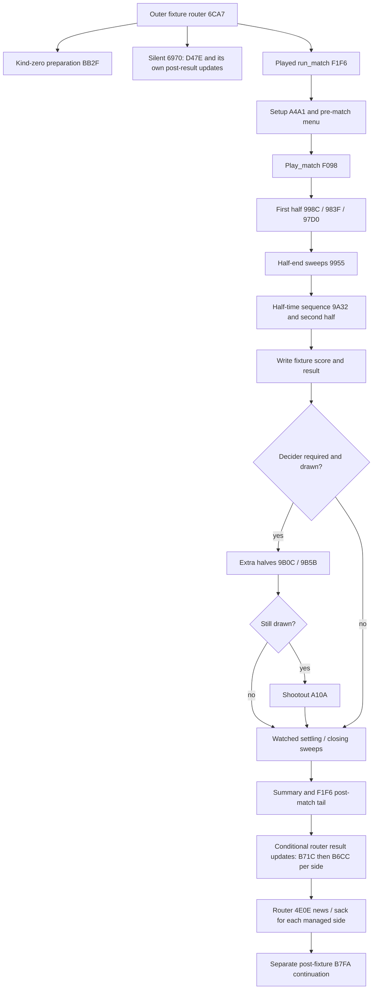
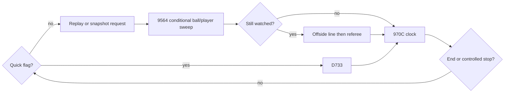
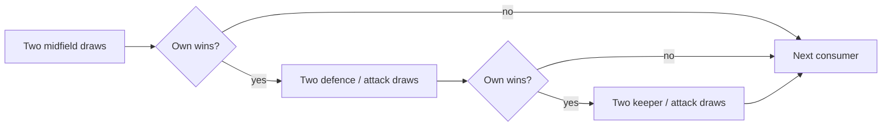

# Match flow: from records to field events and persistent updates

This is the foundation reading path through the engine. Start here for control flow, then use
the [inventory](inventory.md), [stored player fields](player-fields.md),
[derived traits](player-derived.md), [persistent context](match-fields.md),
[live state](transient-state.md), [effective skills](attribute-formulas.md),
[strength](strength-formulas.md), [skill gates](skill-gates.md) and
[opposing contests](contest-formulas.md) for the values moving through it.

The [flow ledger](../../notes/engine-study/T100/flow-v2.json) binds this reading to original
locations and extracts the port's lexical guest-call sites. Static call order is not a dynamic
execution count: branches and loops still control which calls happen.

## Code layers and machine fidelity

| Layer | Responsibility |
| --- | --- |
| Image / record adapter | Locate the original program/DS, read packed records and expose the memory component. |
| Match | Validate the image/options, declare record/fixture interventions, install selected ports, expose events/answers/save/load/results and run the post-fixture continuation. |
| Machine | Unicorn-backed execution, original register/memory state, instruction sites, watches and routine replacement hooks. |
| Registry / ports | Bind original segment:offset entries and return conventions to Python replacements. |
| Mem / Regs / guest calls | Read/write the same bytes, preserve machine-visible values/stack frames, emit writes/sites at the original locations and suspend/resume cross-routine calls. |
| Proof / family comparison | Debug original-versus-port calls and compare declared whole-scenario records; scoped evidence rather than universal reachability proof. |

A `yield call("0791:...")` names an original address, not necessarily execution of the
original body. Dispatch can run the installed Python port or the original callee.
Without selecting ports the kit still uses original execution; selecting all installs the
registered replacements. This is distinct from T78's independent runtime without Unicorn.

The Python often looks like assembly because it preserves more than football equations:
16-bit wrapping, packed/unaligned words, far-pointer conventions, low/high register bytes,
nested procedures' parent-BP access, stack locals and return-pop sizes. Boolean language can
refer to AL even when AX is not a clean host0/1. Numeric-return equality alone does not prove
machine-state equality. The [named arithmetic chapters](attribute-formulas.md) are explanatory
models, not a replacement backend or a full ABI proof.

Primary code: [Match](../../runtime/original_match/match.py),
[Machine](../../runtime/original_match/machine.py),
[registry](../../runtime/original_match/port/__init__.py),
[memory](../../runtime/original_match/port/mem.py),
[guest frames](../../runtime/original_match/port/guest.py) and
[frame ports](../../runtime/original_match/port/frame.py).

## Fixture-to-result control flow

The original outer router6CA7 distinguishes preparation without play, a silent result and a
played match. The kit's Match adapter starts the played run_match path, rather than reproducing
every campaign-router choice.



Setup derives current countries/venue, selects/corrects computer lineups, creates pitch values,
seeds/fills the foul table and establishes budgets/state. The kit's optional main-seed override
is later at a declared captain or computer-kickoff hook; budget overrides occur at play_match
entry after defaults. An input edit at those boundaries is not an edit before every setup effect.

F098 calls first_half, half-end sweeps and the half-time/second-half sequence, writes the
fixture score/result, then conditionally extra time and shootout. Watched settling can call9564
directly outside97D0. The tail includes summary, table/history, reset/pool and player-restoration
stages; detailed lifecycle belongs to T104.

The original router calls F1F6 at 6F18. Its result-update branch (managed involvement and
kind not friendly) then calls B71C and B6CC per side at 6F80/6F86. For each managed side,
it calls 4E0E for post-match news/sack checks at 6FD8, before B7FA at 6FF8.
These are conditional outer-router calls, not unconditional work inside F1F6.
The kit calls F1F6 followed by B7FA; it omits this outer B71C/B6CC/4E0E sequence.
The diagram above describes the original route, with those original-only stages explicit.

The outer/kit post-fixture B7FA entry updates participants and other squad state separately.
A full-time board/event is not by itself a guarantee that all campaign/participant updates
have completed. Follow the selected adapter/continuation contract instead of guessing a
transaction boundary from a screen.

## One ordinary watched iteration

Normal half execution enters97D0 with its ordinary low-byte flag zero. In one iteration:

1. If quick flag9A3E is nonzero, call D733 instead of the watched branch.
2. Otherwise handle a pending original action replay0C65, or a snapshot15B9 when no replay
   takes precedence; clear the associated request flags as the source specifies.
3. Call9564. Its22-slot sweep interleaves eligible ball phases with player work: ball movement,
   nearest/holder selection, possible extra keeper update and play-at-ball checks, then each
   mapped slot's availability/state handler/run step, sound, ball drawing and key polling.
4. If the sweep has not switched to quick mode, update the offside line8CF5 and referee9119.
5. Call970C, then repeat until the half-end result or the alternate controlled-stop predicate.



These lexical sites are extracted from the pinned source; mutually exclusive/repeated calls
must not be flattened into one unconditional sequence:

| Source call site | Target | Python location |
| --- | --- | --- |
| `0791:97DA` | `0791:D733` | `frame.py:620` |
| `0791:97E6` | `0791:0C65` | `frame.py:623` |
| `0791:97F2` | `0791:15B9` | `frame.py:625` |
| `0791:980B` | `0791:9564` | `frame.py:630` |
| `0791:9815` | `0791:8CF5` | `frame.py:632` |
| `0791:9821` | `0791:9119` | `frame.py:635` |
| `0791:9825` | `0791:970C` | `frame.py:636` |

The sweep is not one independent action per player. Ball gates depend on event, timer and
tables; player order uses DS:0883; availability can skip a player; a keeper can receive an
additional update. A key poll can switch mode partway through, ending the sweep before later
slots and skipping the usual offside/referee work. Direct closing/restart sweeps have their
own stopping predicates rather than the ordinary half loop's clock.

Attributes feed several stages: skill affects a gate or launch reach; reach changes ball
phases and interception chances; position/foot/status affect targets and eligibility; movement
activity spends energy, which changes later values; goals/cards/comments can change form,
ratings and availability. A local formula does not collapse this stateful feedback into one
match probability.

## Clock and half boundaries

970C only enters its counter logic when live gate8325 is nonzero. If subtick831D is nonzero,
it decrements it and does not advance the minute on that call. When it is already zero:

- Test regular remaining831B plus added time8321 for zero; set the end-time flag.
- If time remains, consume regular time first, otherwise added time.
- On the time-remains branch, increment elapsed831F while below128. Reload subtick to36
  after that branch, including the terminal check.
- Check the half-length threshold (signed byte8319) or end-time flag and return the end result.

A projection with subtick36, remaining10 and elapsed81 illustrates the ordering:

| Eligible call | Subtick after | Remaining | Elapsed | Advanced? |
| ---: | ---: | ---: | ---: | --- |
| 1 | 35 | 10 | 81 | no |
| 36 | 0 | 10 | 81 | no |
| 37 | 36 | 9 | 82 | yes |

Thus there are **37 eligible clock calls between these advances**, not an unconditional
36 frames per displayed minute. Paused/dead-ball gates, direct sweeps outside the clock,
quick code resetting the subtick and the terminal check all affect the global relationship.
This is a source-derived counter projection, not a fresh timing measurement or a full
machine-state clock model.

The ordinary first half starts with remaining91 and threshold45; the second-half sequence
continues the state after the half boundary. Extra-time setup9B0C explicitly sets remaining31,
elapsed89 and threshold15 before its two halves. The raw counters are not a modern elapsed-time
API. The clock may run a terminal iteration without incrementing the display; quick trials
occur before the clock test, so an ending minute number is not the number of D733 calls.

The added-time field is a current accumulator: identified event writers add while it is below5.
That is not automatically a universal five-minute cap on total extra play if new increments
occur while time is being consumed. The full event/restart lifecycle remains part of T104.

## Randomness, events and saved continuations

### Draw sites and why branches shift the stream

Setup `2648` assigns the main seed word `U16(fixture_index*(elapsed_year+1))`, then
calls `rand(16)-1` 255 times at 2682 to fill foul-table entries 1..255. The index is
initialised from the second country. This happens before the kit's optional captain or
computer-kickoff seed intervention, so that intervention does not resample the foul table.

The ordinary watched sweep contains conditional ball phases, variable player work and
movement retries. Its draw count is not fixed. In `8889`, being off the target square
reaches the sprint-axis coin at 8A2E; a failed movement attempt can additionally reach
`rand(5)` at 8AD1 before retrying. Changing a target, occupancy result or branch can
therefore add draws before later players or ball work use the same main stream.

| Original call site | Draw / condition |
| --- | --- |
| `0791:2682` | Setup `rand(16)`, repeated 255 times; stored byte is draw minus one. |
| `0791:8A2E` | Sprint-axis coin in an off-target movement path. |
| `0791:8AD1` | `rand(5)` after a failed move; retry path. |
| `0791:B1DA`, `B1EC` | Quick attempt: opponent midfield draw, then own midfield draw. |
| `0791:B20E`, `B220` | Only after midfield success: twice opponent defence, then own attack. |
| `0791:B23F`, `B251` | Only after defence success: opponent keeper, then own attack. |

The [historical E011 instrumented half](../../experiments/E011-q010-watched-engine/rng-counts.txt)
records 91,985 main-seed draws over 2,077 ticks (about 44.29 per tick), with 0..6 ball
phases and 1..23 sprint-axis coins per sweep. These are observations from that particular
half, not universal limits or a fixed tick budget. The ledger re-reads its histogram totals;
no new match or original-code run was made here. [F013](../../findings/F013-the-watched-engine-tick-map.md)
connects these counts to the source's movement and sweep branches.

The quick-attempt routine B19D provides a bounded example of the same dependency:



One attempt takes 2, 4 or 6 draws because each strict signed loss/tie exits immediately.
At entry seed 0, fix own keeper/defence/attack to 2/1/8 and opponent lines to [2,1,2,2].
Changing only own midfield from 1 to 8 gives this source-derived local projection:

| Own midfield | Opponent/own results, in order | Draws | End seed | Next common `rand(100)` |
| ---: | --- | ---: | --- | ---: |
| 1 | midfield 1/1: tie, stop | 2 | `0x3B22` | 97 |
| 8 | midfield 1/2: win; defence/attack 2/1: loss, stop | 4 | `0x1E54` | 53 |

The next call has the same bound but starts at a different point in the stream.
Unconditionally consuming six draws would falsely align the two end seeds; the projection's
negative control detects that error. This is arithmetic from B19D/0688 with declared line
inputs, not a measured match, natural-lineup claim or probability estimate. See the
[contest chapter](contest-formulas.md) for full one-attempt enumeration. It is B19D, not
the tackle routine 5474, that supplies this three-stage example.

### Events and saved continuations

The main LCG, precomputed foul table/index, separate sound seed and original replay snapshot
have different roles. Setup/table generation precedes later seed interventions. Restoring only
one word does not restore the whole input state. Likewise, callbacks/answers and key discipline
matter: the clock can be stopped while other code still runs. Host delay/FPS is not the
simulation's sole time source.

Goal/stat/comment events must follow the original writes and order. Watched score increment
and cancellation differ from quick scratch clear/trial writes; D733 commits at most one goal
after its trial postprocessing. Inferring events from a final score would lose tentative,
cancelled and intermediate actions.

The adapter's optional tick site is970C entry, not one physical football second. Port writes
use the memory/site machinery to preserve the original hook points even though host writes do
not automatically trigger Unicorn's guest-write hooks. Queueing/stopping a port and later
reconstructing its frames are implementation boundaries that a readable rewrite must address.

Original action-replay buffers and Match.save/load's live-port reconstruction are different
mechanisms. Current snapshots, stack/call context, answer policy and cached values belong in the
selected continuation contract. This study does not change that contract or deliver the
standalone T78/T80 backend.

These foundation interpretations are subject to ES-R1 review.
The source/lexical/clock check below is structural/analytical; it does not claim dynamic call
coverage, every possible key path, whole-match equivalence or natural frequencies.
Known source/state/frontier limits remain in the earlier chapters and issue register.

```bash
python3 -B notes/engine-study/foundations/check.py --task T100
python3 -B notes/engine-study/T100/make_flow.py --check
```
