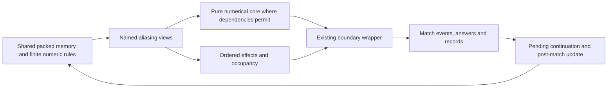

# What a more readable engine must preserve

A more readable faithful engine is possible in principle: name storage and isolate a rule while
preserving its existing effects. Replacing the entire machine representation is a larger,
different compatibility decision. This chapter defines the obligations before comparing the
four design options. It neither implements a replacement nor weakens the existing proof.

## The code being assessed

The source baseline is accepted m7, commit `f55ef8314c1da390eb96091efe2bdab7b73fa534`.
The [T110a ledger](../../notes/engine-study/T110/T110a-v1.json) records an exact registry
inventory of that snapshot, all exported runtime source hashes, and the source line behind
each obligation. The [producer](../../notes/engine-study/T110/contract.py) imports registry
definitions from a temporary frozen Python-source export. It constructs no Match, reads no
original image and invokes no registered engine routine. This is membership, not reachability.

Do not carry the old [T95 inventory](inventory.md)'s 21 modules/423 addresses forward as a
current denominator: it belongs to 08beac2e, before standalone entrypoints and Real helpers.
Likewise, 201 scoped entries in the field-study receipt are a chapter frontier, not the
whole registry, and 75 historical family cases are neither exhaustive branch coverage nor
independent samples of football. Later T78c/T79/T80 delivery is outside this pinned assessment.

The current runtime already supplies useful abstractions: Rec over shared packed records,
Mem accessors, guest frames, a plain-memory dispatcher, and a public Match event/answer API.
The assembly-like parts are often deliberate: partial registers, far calls, parent frames,
write sites and finite arithmetic preserve an observable continuation. Renaming those parts
can help; deleting them requires an actual replacement contract and evidence.

## Compatibility levels

| Level | What equality means | Decision boundary |
| --- | --- | --- |
| machine-boundary | Preserve each selected routine's existing declared ABI, relevant physical memory, ordered writes/sites/draws and caller continuation; keep full-state diagnostics and known differences visible. | Default basis for an in-place readability change; this assessment does not redefine the proof. |
| public-api-records | Match events/decisions, records, RNG trajectory and supported continuation remain exact, but DOS registers/stack may cease to be an exposed representation. | A different contract requiring explicit owner choice, consumer audit and independent end-to-end proof. Not adopted here. |
| redesigned-semantics | Rules, quirks, outputs or random consumption may intentionally change. | A separate game-design project, not a faithful rewrite. Not adopted here. |

The first level is not a claim that the accepted port already equals all original physical
state. T106 matched selected fields and declared ABI for 18/18 pairs, full memory for15/18,
all captured registers for3/18, and both together for0/18. Existing scratch arithmetic-flag
policy and the unresolved launch-frame residue must remain disclosed. No new mask or
unproved “dead memory” exclusion follows from a domain-oriented API.

The wrapper and effects are part of the proposed design, not cleanup to be discarded.

## Twelve obligations

### arithmetic

Keep unsigned/signed byte and word interpretations, overflow at the original stage,
truncation toward zero, strict thresholds and clamp order. Host float is not a replacement
for the existing 40-bit Real model. The [strength reader](strength-formulas.md) has a form32
discontinuity and clamps before placement. Existing retained numerical returns validate a
sampled numerical projection; a helper returning that value does not reproduce AX/DX, frame
writes or all exceptional paths. The ledger names the original377E signed-division site.

### random-order

Main LCG and table-byte state are separate. Preserve the cursor, bounds, draw results and
the conditional sequence, including failed movement retries. Equal seed and equal final
score are weaker observations. Tests must compare ordered draws and relevant effects; an
extra coin, changed retry condition or reordered player update can alter all later play.

### occupancy

The picture is simulation state. Character and attribute words, background restoration and
sprite ordering affect blocked movement; attribute13 can admit a character otherwise blocked.
A boolean occupied flag loses information. Retain exceptions for holder/challenger/keeper
without accidentally bypassing coordinate bounds. The [movement chapter](movement.md)'s
blocked-step example is supplied-draw arithmetic, not a new seeded match result.

### event-order

Public events are stamped at observed writes. Preserve their full data, order and score/minute
context, including provisional goals and rollback. Keep working score, retained fixture goals,
shootout tally, player statistics and commentary separate. Computing an identical final
result and emitting a convenient event list afterward does not meet this obligation.

### decisions

Pause, half time, substitutions, extra time, optional taker choices, defaults and refusals are
continuations. Pending/queued events and the point before/after an answer matter. A failed
answer can return to the same decision. Preserve existing public boundaries and separately
disclose the [original-key gap](https://github.com/diegoami/goal2-archaeology/issues/400);
an API-constructed scenario is not evidence of natural keyboard reachability.

### modes

Watched, quick and outer silent results are different algorithms. Match is an admitted played
fixture adapter, not the entire career router. A readable transition model needs an explicit
mode, not a single “simulate result” function that silently substitutes one path for another.
Broad T79 fidelity and rare natural reachability remain separate obligations.

### phase-tail

F1F6 completion and B7FA player update are separate entry paths in Match._advance. Finished
public records include the latter. Restoring saved form/energy, subsequent recovery and outer
campaign news are different lifetimes. An event-state redesign must preserve that order and
define its terminal boundary; it cannot treat the full-time board as the entire public result.

### public-api

Preserve default original backend, explicit engine identity, option/refusal behavior,
event/answer/result grammar, complete records and the downstream #427 interface obligations.
A future alternate backend must meet its declared adapter contract. Fresh-career delivery,
sealed packaging and old-career migration are separate owner/delivery questions; no such
capability is inferred from this analysis.

### checkpoints

At m7, supported original-engine save/replay preserves public event and pending-answer state;
engine=port save/load is explicitly refused in this assembly slice. Original backend plus
installed Python ports is not the same checkpoint implementation as the plain port backend.
Do not import later T78c capabilities into this snapshot. A new transition model needs its
own exact reconstruction, pending-queue, refusal and RNG evidence.

### identities

Player, country and live pitch records share storage through packed far pointers. A named
view must preserve 16-bit offset wrapping, aliasing, reserved bytes, cache lifetimes and
writer hooks. A copied dataclass is a snapshot, not automatically a replacement view.
Persistent identity, pitch slot, side and host context must remain distinct; refreshing a
derived value after an arbitrary edit can differ from the normal bind/setup sequence.

### machine-state

Compare a readability candidate to the accepted port at the same boundary, preserving all
observed state and ordered effects, then retain independent original comparisons under the
existing disclosed contract. Preserve wrapper register/frame work even when the domain
pseudocode omits it. The [launch residue](audit-boundaries.md) remains unresolved under
[#591](https://github.com/diegoami/goal2-archaeology/issues/591): plausible frame arithmetic is
not an alias/liveness proof. No automatic removal of sound/display-looking writes follows.

### evidence-scope

Keep static interpretation, retained original return, differential test, synthetic direct
probe, natural reachability and match effect distinct. The [T107 revision proposal](t107-revision-proposal.md)
is not an executable batch or scoring result. Old records retain their source pins and
immutable bytes. A prototype needs independently produced expected results and negative
controls under its own accepted contract and spending cap; none is executed by T110.

## Validation and boundary decisions

Run the producer's --check and the T110a check.py contract to reproduce source membership,
line references and record structure. Negative controls reject missing obligations, missing
evidence/limits, altered source quotes and mock evidence. They cannot prove the architectural
interpretation. Existing T98/T101/T106/T109 results retain their original coverage and gaps.

A proposed interface may document a stronger diagnostic or a different contract; adoption is
an owner decision. The default recommendation must not rely on silently losing memory,
arithmetic, draw or continuation semantics. The next chapter will make four representative
changes concrete and state the machine work each sketch deliberately leaves in its wrapper.
