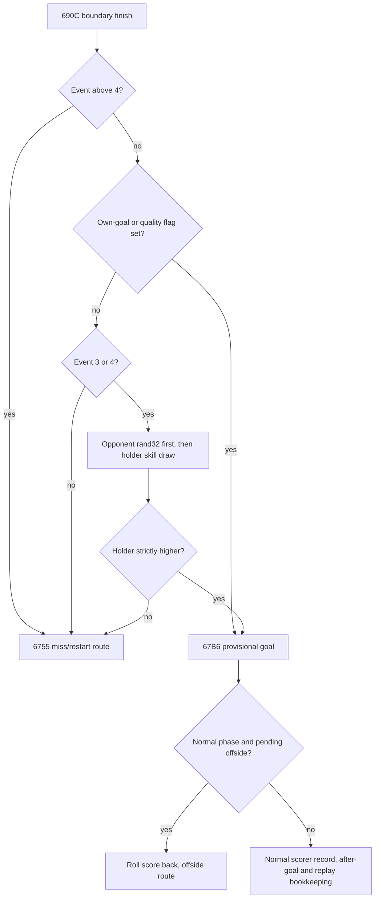

# Duels, accepted goals and the next phase of play

Contact, a successful contest, possession, a save and an accepted goal are different stages.
The current selectors, ball flags, geometry and earlier actions determine which stage runs.
The same skill can therefore enter a different bound or be bypassed on another route.

The [source ledger](../../notes/engine-study/T102/T102c-v1.json) explains 23 scoped routines
and assigns all 55 T102 registry entries. [resolution.py](../../notes/engine-study/T102/resolution.py)
checks supplied source-derived contest and bookkeeping cases. It creates no Match, executes
no original/port routines and adds no match observations. Interpretations remain proposed
until independent ES-R2 review; the numerical [contest chapter](contest-formulas.md) retains
its separate local-probability assumptions.

These contact/launch controllers describe watched field play. Quick/silent result generators
use other mechanisms; quick play can reuse `6443`/`65FE` bookkeeping without running these
watched duels. The [frame chapter](match-flow.md) separates those execution paths.

## Contact is not one contest

An intended receiver can acquire the ball through the selected-record branch in `8AE9`.
After its movement, the record must still be `830D`, be at the ball, have state other than
12, and satisfy the moving-ball condition. That branch calls `869F` and then restores the
previous `8303` air flag. It does not call a heading gate. With different old/new holder and
old air clear it can submit template 0x19; the air case can change possession without that
line. This is distinct from an unselected player's reaction, so text alone cannot count all
completed receptions. Selection, offside/miscue changes and movement must preserve those gates.

`6188` handles other at-ball encounters in watched play, excluding state 13. Keeper slots
enter `5B36`; unselected nonholders under additional phase conditions enter `5F8A`.
That reaction reader considers remaining travel, air, geometry and skill gates:

| Context in `5F8A` | Identified skill use / continuation |
| --- | --- |
| Near, ground, attacking-zone shot opportunity | Control 9 gate can lead to a shot. |
| Near, ground, ball timer nonzero | Side-dependent table uses tackling 3 on the defending side, control 9 on the holding side. |
| Far ground travel | Tackling 3 gate can lead to a deflection. |
| Near aerial ball | Heading 4 gate, then geometry chooses clearance, header or deflection. |

`5E41` draws/coins an offset per axis, installs the deflector as holder and relaunches event 6.
`5EAB` installs possession, recomputes nearest teammates and temporarily sets `80FA` while
passing toward that nearest selector through `384C`. `5F06` chooses between these paths
using cached **air flag `8303`** and an event set, then can set air from another coin. The
port's local name moving refers to `8303` here, not the distinct play flag `8302`.

The opposing contact challenge `5565` has availability/position/phase gates and can run a
keeper duel, a tackle, a foul branch or a clearance. Its completed route can add **10 directly
to the challenger's player performance word** at `56CB`, with no corresponding ring line.
The player `+12` word is not the pitch `+12` state byte. F014's performance evidence covers
that quiet write; a line-only rating reconstruction misses it.

For `5474`, the holder draws first, and the challenger must draw strictly higher:

| Ball context | Holder bound | Challenger bound |
| --- | --- | --- |
| Ground | effective dribbling 10 | effective tackling 3, times four only when the challenger own-half predicate holds; otherwise times one |
| Air | effective heading 4 | effective heading 4 |

The challenger win enters `539F`, whose historical foul-outcome name is misleading. It can
give clean possession, a deflection or a clearance, and delays the old holder where applicable.
Thus winning the local roll does not alone establish a completed turnover.

`4DA9` supplies a separate foul predicate. Its initial random-is-one(18-hardness) draw occurs
before checking effective go-in-hard element 4. Admission then compares holder/challenger
hardness rolls, with a strict challenger win. Go in hard changes admission, not the stored
tackling skill; the initial draw still occurs when that tactic is on. `5513` then uses a coin
to choose the watched foul sequence or the won-ball resolution. Cards, injuries and restart
management continue in T104.

Keeper `5B36` has several contexts. At feet, ground compares holder dribbling with keeping,
adding one **inside the keeper bound** except for one template context; aerial compares holder
heading with twice keeping. In a moving-ball branch the difficulty draw comes first:
`rand(4*remaining_travel)` plus a conditional penalty term is compared with the keeper's roll.
The selected keeper element and penalty admission have their own tables/mode gates. An eligible
successful flight threshold then chooses rebound, wide parry or clean save via another draw.
Losing the earlier ground/air comparison can still enter a foul-related save/recovery branch.
One pairwise probability therefore does not equal the whole keeper save probability.

`5A33` submits save/parry text, updates the saves byte and clears selected event state under
the normal `8326` guard. `5A8E` wraps possession/timer handling, template 0x1D and a following
delay or clearance. A save can start another launch immediately; recording a save is not the
same as requiring a stationary ball in the keeper's hands afterward.

## From the goal line to an accepted goal

The centre/forward boundary route described in [ball flight](ball-play.md) reaches `690C`.
That routine also serves normal finishes despite its historical penalty-contest name:

An unconverted event above four takes the miss route even if its geometric path crosses
the mouth. `6755` places ball y at signed 39, submits a miss line, sets sound-envelope word
`832A` to 20 and invokes restart/offside handling. `698E`, on the other goal-line direction,
can choose a corner or set event zero/own-goal flag before `690C`. These are source route
conditions, not a claim that every apparent goal-line crossing scores or awards a penalty.

`56D9` handles a pending offside notification: it requests the marker/message and submits
template 0x42 once through `8329`. Its low-byte return is always zero, so it does not itself
short-circuit the later `57AC` branches. Actual offside handling occurs through `82EB` when
another action/boundary/goal path reaches it. Distinguish candidate, notification and adjudication.

`67B6` clamps the displayed ball point, submits a keeper-related line, increments the credited
score byte and draws the score. An own goal reverses the holder's side for credit. In normal
`8326`-clear play, pending `830E` then subtracts that provisional goal, invokes offside and
returns **before** scorer recording, after-goal feedback and the replay request. The port kit
can expose both the provisional goal and its disallow event. Moving the validation before the
increment in a rewrite would need to preserve that observable sequence explicitly.

An accepted normal goal reaches `6443`. It increments the normal scorer's persistent goals
word, optionally updates top scorers for the fixture kind, changes scorer form and writes a
goal-list player identity/minute. Own goals have different player-goal/form handling and are
logged on the credited side. The per-side list saturates at eleven: further goals overwrite
row eleven rather than appending indefinitely. Score/player totals are separate from that
display-history capacity.

The minute is stored as a byte, adding 0x80 modulo 256 when `8324` or the own-goal flag is set.
Do not replace that with unrestricted time plus separate flags while claiming identical saved
bytes. Behaviour above the usual minute range needs its own reachability/compatibility contract.
In `8326` mode, `67B6` bypasses normal scorer recording and the pending-offside branch; later
shootout handling must retain those distinctions.

## After-goal feedback and random consumption

`65FE` enables activity, whistles, and copies player points into targets. In normal play it
calls `65A4`, computer tactic update `C173`, then the per-available-player form swing. `65A4`
sets holding-side outfielders to state 6 and others to zero, then calls `6337`.
The scorer's own form write and the team-wide live form change are separate operations;
T104 traces what survives restoration/post-match processing. A numeric +1 is not uniformly
beneficial at the [form-32 cutoff](audit-arithmetic.md), so “scoring boosts every later skill”
would be too strong.

`6337` has a keeper-specific transfer: send the keeper toward its post, draw an initial
outfield slot and advance past unavailable players. The watched branch then gives the holder
a random target, even if the keeper branch did not run. It consumes a coin, rand(5) or rand(25),
and another coin. That is **three** explicit main draws for a watched nonkeeper holder, four
with the keeper transfer; the quick branch omits those three. The old annotation's “no other
draws” applies poorly to the full body. These celebration targets are simulation state, not
only screen output.

State-6 handler `6240` uses holder/target/score conditions while moving players through this
phase. Eventually `61EC` stops activity, checks substitutions and chooses a conceding-side
outfield selector before setting kickoff-placement state 1. After an own goal the side rule
is reversed appropriately and the own-goal flag is cleared. T104 owns the management/restart
details at that boundary.

Word `832A` is separate. The after-goal writer compares score indexes selected by the saved
own-goal flag and produces 50/100/150; it is unsafe to relabel that as a generic scoring-side
aggression value. The identified reader `94E8` uses it for the sound envelope through the
separate `8336` RNG word, and `9564` decreases it by two per completed watched sweep. This
audit identifies audio/decrement readers, not a verified gameplay-pressure effect of that word.
The whistle, audio state and celebration's main draws must be distinguished.

Finally `67B6` requests action replay via `7C37` unless already replaying, in which case it
clears replay mode and restores the saved speed context. The [frame chapter](match-flow.md)
explains the snapshot/continuation boundary. Reapplying accepted-goal or post-match effects
while restoring replay would duplicate state changes.

## Worked paths and rewrite limits

With source-stage seed zero, holder dribbling bound 80 first draws nine. Challenger tackling
30 then draws seven and loses; the fourfold ground-geometry bound 120 instead draws 28 and
wins. Both local pairs consume two main draws. The win still needs `539F`'s subsequent
resolution, and a changed branch can consume different draws afterward. This is not a new
measured turnover rate.

For the conditional event-3 finish at decision-stage seed zero and effective value 32,
opponent rand(32) is four, holder rand(32) is eight, so `690C` reaches `67B6`. Reversing those
draws gives the opposite result. Assume normal play, holder side zero and score `(1,0)`:
with no offside, the score becomes `(2,0)`, scorer recording and after-goal/replay bookkeeping
follow. With pending offside, the displayed provisional `(2,0)` returns to `(1,0)` with no
normal scorer record or after-goal feedback. The example connects source decisions and state
writes without simulating the full goal routine's commentary/celebration RNG.

For a selected reception in slot nine, assume `830D` still names nine, state five, at-ball,
old holder six and the additional `8AE9` predicates. Acquisition clears selectors, moving
flag, timer and event, then restores old air. Ground can submit 0x19; air can acquire without
that line. This path illustrates why changing only a heading rating does not affect every
reception in the same way.

The script rejects inclusive tackle ties, reversed finish draws, recording before offside,
unlimited scorer history, removal of celebration draws and unconditional air clearing after
selected acquisition. It checks ordinary supplied values and partial state projections,
not complete original call frames or natural encounter frequency.

T102 now accounts for all ball/contest/duel entries plus the three motion entries deferred
from T101. Restart, card/injury and management paths are explicitly handed to T104; whole-match
effects await the preregistered experiments. A readable design can expose contest, possession,
provisional score, accepted scorer record and feedback as separate stages while preserving
their original ordering, random sources, cached context and externally visible events.
